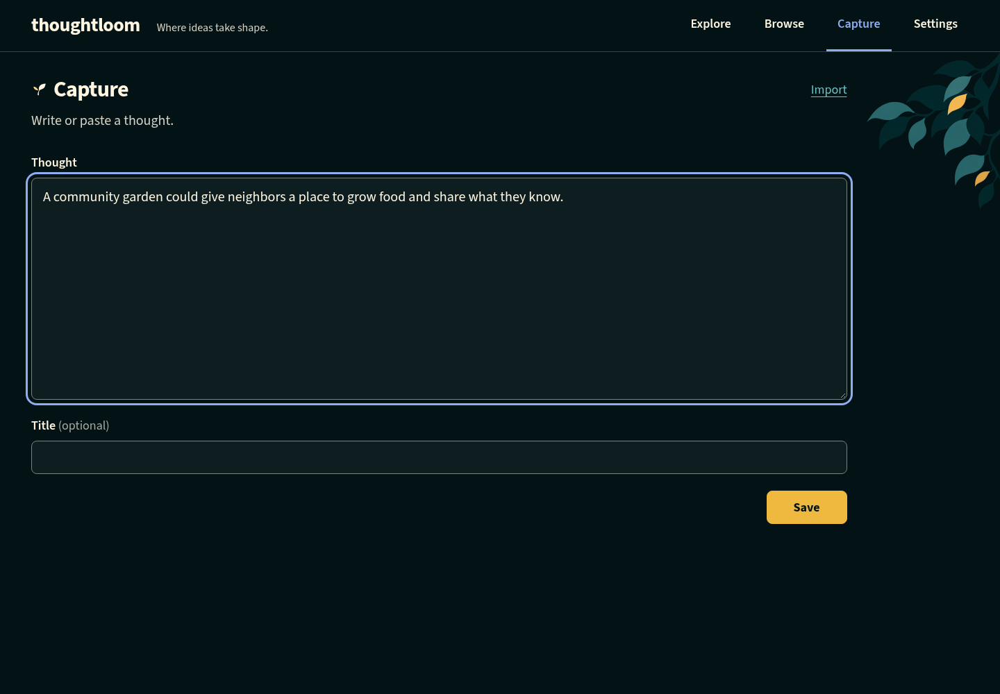
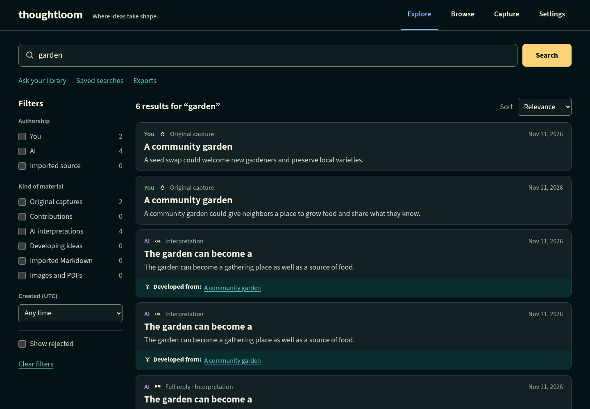
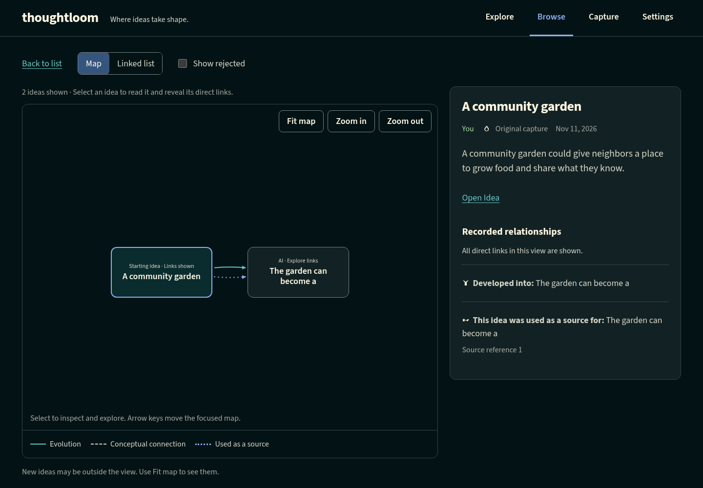
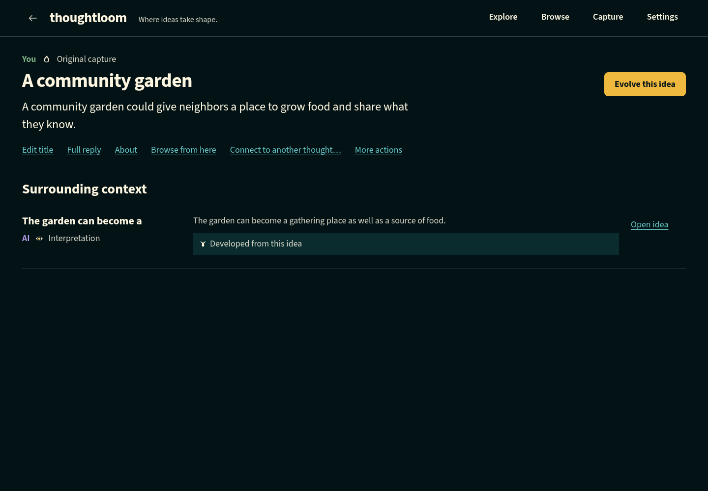
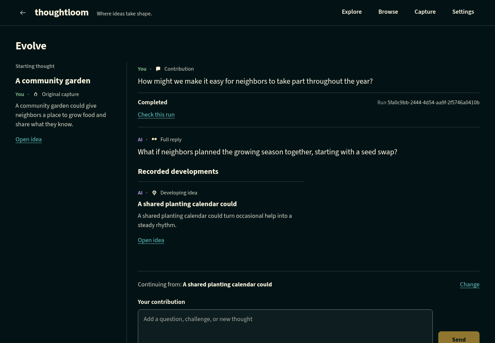
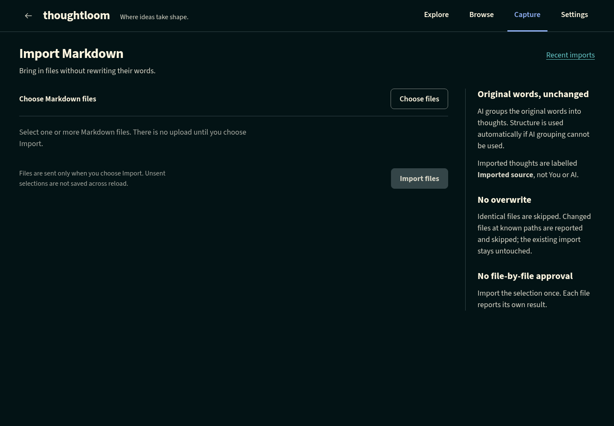
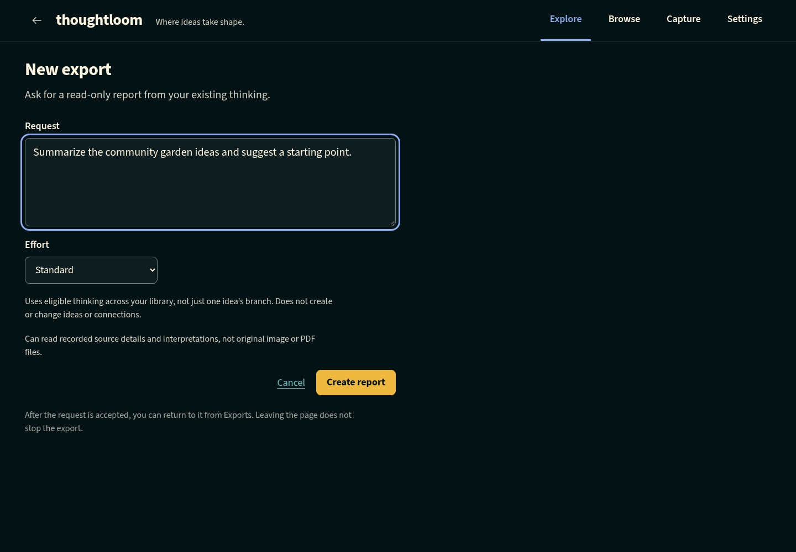
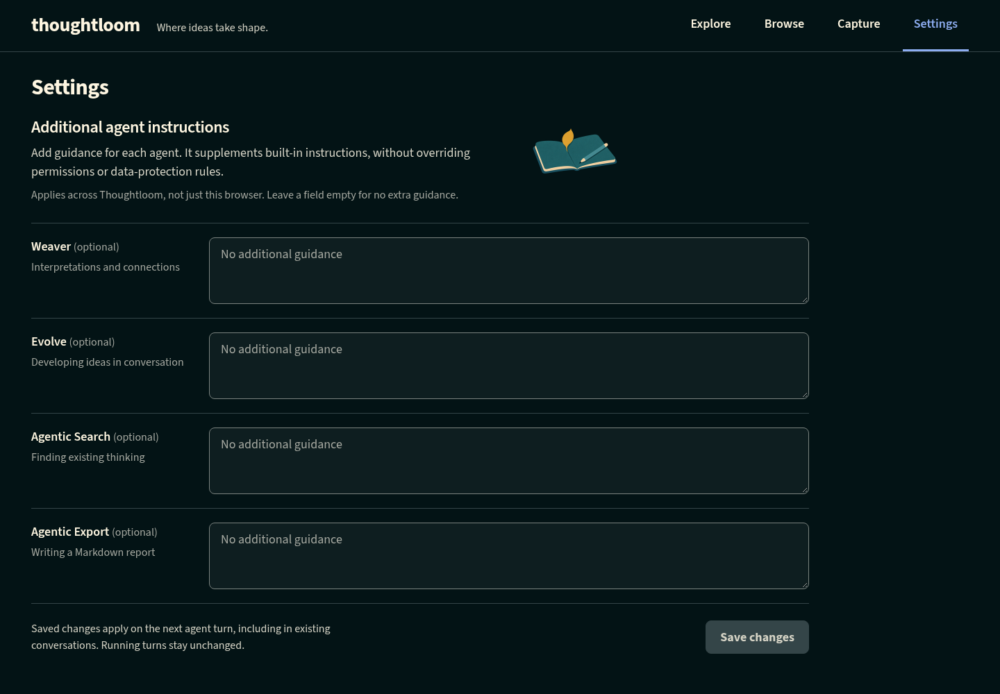

# Using Thoughtloom

[README](../README.md) · [Installation and startup](server-startup.md)

Thoughtloom is a library of connected thinking. Capture an unfinished thought, return to it later, and develop it without losing the original. AI can suggest interpretations and connections, help you explore your library, or develop an idea with you. Its contributions remain attributed to AI, not silently adopted as your own.

Screenshots show the current desktop app with a synthetic community-garden library. AI-labelled text in these examples comes from a deterministic test agent, not a live model. Your library and generated results will differ. Import and export screenshots show setup, not completed operations.

## In this guide

- [Start with one thought](#start-with-one-thought)
- [Understand your library](#understand-your-library)
- [Find and browse ideas](#find-and-browse-ideas)
- [Read, title and connect ideas](#read-title-and-connect-ideas)
- [Develop an idea with Evolve](#develop-an-idea-with-evolve)
- [Request another interpretation](#request-another-interpretation)
- [Import existing material](#import-existing-material)
- [Ask your library](#ask-your-library)
- [Export your thinking](#export-your-thinking)
- [Set additional agent instructions](#set-additional-agent-instructions)
- [Reject and restore material](#reject-and-restore-material)
- [Recover when something goes wrong](#recover-when-something-goes-wrong)

## Start with one thought

Open the web address supplied by whoever runs your Thoughtloom installation. If you are setting it up yourself, follow [Installation and startup](server-startup.md) first. You do not need to configure a model to capture thoughts or use ordinary search.

1. Choose **Capture** in the main navigation.
2. In **Thought**, write something worth returning to. For example: “A community garden could share tools as well as growing space.”
3. Optionally give it a title, such as “Sharing garden tools.” You can change the title later.
4. Choose **Save**. Wait for confirmation before closing the page.
5. Choose **Open idea** to read the saved thought, or **Capture another thought** to start a new one.

Saving records your thought immediately when confirmed. It does not wait for AI. With agents configured, background processing called *weaving* can add interpretations and connections later. Without agents, that work stays queued; your thought is still saved.

An installation can optionally screen newly saved text locally for possible connections, including captures, Markdown, Evolve contributions/developments and AI interpretations. Original image/PDF descriptors are not screened; their saved text interpretations are. The Weaver still decides whether a connection is warranted and can search for others. Connection-only work does not create interpretations or another Full reply. If screening is unavailable, discovery falls back to search; the screening results are not shown as evidence. See [connection screening configuration](server-startup.md#optional-connection-screening).

Local screening skips two thoughts already joined by an active connection, in either direction and of any category or authorship. They are not nominated again by that screening pass. Rejected connections do not count; later reviews reconsider pairs that are no longer connected. Weaver can still search independently.

An ordinary daemon restart retains completed screening progress and resumes only unfinished, still-unconnected pair checks. Known screening failure stays on search fallback for that run. A connection added during a local call cannot undo the call, but prevents nomination if present when the initial prompt is saved. Already-saved prompts are not rewritten. Restoring a backup does not restart historical AI work.

With agents configured, quiet daily review revisits a bounded selection of eligible text thoughts for missing titles and useful connections. No review screen or daily action is required. A current title is never replaced by a late AI fill, and no change is a valid review outcome. The initial cap can make a full rotation take longer than 30 days; see [daily review operation](server-startup.md#agent-configuration).

**Keep a copy of important unsaved text.** Capture has no guaranteed autosave, offline queue or draft recovery after a full refresh. If you see **Not sure it saved**, keep that page open and follow the [recovery guidance](#recover-when-something-goes-wrong) rather than saving again immediately.

## Understand your library

| Term | What it means in everyday use |
| --- | --- |
| Thought / idea | A saved piece of thinking. The Idea screen lets you read it and act on it. Its wording, authorship, creation time and development ancestry do not change. |
| Title | An editable label, separate from the saved wording. An untitled thought can display a short text fallback instead. |
| Evolution branch | A chain of developments. Each new thought has one development parent; developing an earlier point can create another branch. |
| Connection | A separately recorded relationship between thoughts. It does not make one thought the development parent of the other. |
| Weaver | Background AI work that interprets thoughts and finds connections. Its output does not replace your original. |
| Full reply | A retained AI response, separate from the individual thoughts recorded from that work. Reading it is not an endorsement. |
| Imported source | Material brought in from a document, image or PDF. Its original authorship is unverified; it is not automatically labelled as your writing. |
| Rejected material | Material excluded from normal views and AI use, but retained for deliberate user inspection and restoration. Rejection is not deletion. |

If you want to correct or expand saved wording, capture a new thought or develop the existing one. **Edit title** changes only the label, not the thought itself.

### What needs AI configuration?

Capture, ordinary keyword search, Browse, manual connections and Simple export work without a configured agent. Markdown import can use structural grouping without AI. Image/PDF import can retain the original while interpretation waits.

Evolve, new conversational-search turns and Agentic reports require server-side agent configuration. Settings does not select or enable a model. Ask the person running your installation if these features are unavailable.

AI output needs your judgment. A connection is a suggestion, not proof; an interpretation may miss context. URL access also depends on the installation's tools and source permissions. Thoughtloom does not archive fetched web pages, so a saved source link is not a preserved copy of that page.

## Find and browse ideas

### Search by words with Explore

1. Choose **Explore**.
2. Enter words in **Search thoughts**, then choose **Search**.
3. Refine the results with **Authorship**, **Kind of material**, **Created (UTC)** or sorting. On narrow screens, open **Filters** to see refinements.
4. Expand a snippet to read matching text, or open a result to read its Idea page.

Explore starts with a query, not a recent-items feed. **Clear filters** keeps your query and sort choice. **Show rejected** includes rejected results for your inspection, not for AI access. A **Status unknown** badge means the app could not confirm rejection status, not that the material is active.

Bookmark or copy the search URL to repeat its query and filters. Search words appear in browser history and bookmarks, so avoid sharing a link containing private wording. The link does not freeze the result set: your library may change.

### Browse without a search query

Choose **Browse** to scan ideas chronologically. Use **Newest first** or **Oldest first**, the **You**, **AI** and **Imported source** authorship filters, and **Load more**. All three authorships are selected by default. Imported source includes imported Markdown, images and PDFs whose original authorship is unverified, not automatically your writing. **Refresh list** starts a fresh reading of the list. If no authorship is selected, select at least one to see ideas. **Clear filters** selects all three authorships and hides rejected material while keeping your sort choice. Bookmarked authorship selections, including older You/AI-only links, keep their selected subset.

Selecting an idea title opens its local connected map. You can also enter the map from an Idea's **Browse from here** action. Authorship filters apply to the starting list, not the map's linked ideas.

*This example shows evolution and source relationships. The legend also distinguishes conceptual connections.*

- Select a node to inspect its actual text and reveal the first page of its direct links.
- Choose **Load more linked ideas** to continue that selected node's neighborhood.
- Use **Linked list** if you prefer a list to the visual map.
- Open an Idea when you want its full reading view and actions.

The map grows as you explore. It is not an automatically loaded map of the entire library. Its bookmark remembers the starting idea and inspection scope, not every expanded node or current selection. Reload starts again from that starting neighborhood. List bookmarks likewise remember filters, not all loaded pages or your reading position.

## Read, title and connect ideas

An Idea page shows the saved wording, attribution and available context. **Developed from** links to its development parent when available. **Surrounding context** includes direct developments, connections and supporting sources. Open **Full reply** when available to read the retained AI response; it is separate from the thought.

Thought bodies support Markdown such as lists, headings, quotations and code. Web links open a new tab. Embedded images are shown as alternative text rather than fetched remotely.

### Change a title

Choose **Edit title**, enter the label, then **Save title**. Use **Clear title** to remove it and permit later generation. Clearing does not promise when a new title will appear, and it does not rewrite the thought.

### Make a connection yourself

1. On an active Idea, choose **Connect to another thought…**.
2. Search for and preview the other thought.
3. Choose the relationship category and direction, then explain why the thoughts belong together.
4. Add supporting thoughts if useful. These record what informed the connection, not verified evidence.
5. Review the summary and choose **Create connection**.

Your connection is attributed to **You**. It does not move either thought into a different evolution branch. Keep the editor open until creation is confirmed: leaving the Idea or refreshing clears its draft, and an uncertain save is not automatically resent.

Automatic Weaver/Evolve work does not add another connection with the same direction and category when one already exists, and does not recreate an equivalent rejected connection. An existing connection keeps its original explanation and attribution. This does not prevent you from deliberately adding another manual connection.

## Develop an idea with Evolve

Use Evolve when you want to add a question, challenge or new contribution, rather than replace the original.

1. Open an active Idea and choose **Evolve this idea**.
2. Check **Continuing from** so you know which saved thought you are developing.
3. Enter **Your contribution**, such as “What would make shared tools easy to return without assigning one person to manage them?”
4. Choose **Send** and wait for admission confirmation. A known run ID means the request was recorded, not that development is finished.
5. Read the **Full reply** and **Recorded developments** as they become available.
6. Continue from the selected point, or use **Change** when offered to choose a different saved continuation.

**Open idea** only opens a reading view; it does not select a continuation. To start a different branch deliberately, you can also open an earlier Idea and choose **Evolve this idea** there.

Use **Check this run** to refresh known work. **Stop** requests cancellation while retaining saved developments. It also stops pending automatic connection discovery for that Evolve's saved contributions/developments, without undoing connections already created. It cannot guarantee that remote tools have stopped or undo their effects. Leaving the page does not stop the run.

In-app navigation retains the workspace in browser memory. A full reload opens a fresh workspace and loses its draft and local run references without cancelling recorded work. Copy important draft text and displayed run IDs before reloading. If admission is unconfirmed, do not send the same contribution again: this view has no confirmed run to check or stop.

## Request another interpretation

Choose **More actions → Reinterpret** on an active Idea when you want fresh background interpretation without adding a contribution. Earlier thoughts, replies and branches remain intact. New interpretations appear in **Surrounding context**.

Use **Check interpretation** for current status and **Stop** for a known run. If admission is uncertain, **Check request** checks the same request. **Send same request** is a deliberate resend of that identity, not an automatic retry; it may start work if the first request never arrived.

An unsettled earlier interpretation can block new work. If **Retire this run…** is offered, read its warning carefully. Retirement permanently prevents that run from publishing in Thoughtloom and removes its local block. **It does not stop the remote agent.** Tools already started may still change external files or services, and may overlap replacement work. Retirement does not itself request another interpretation. Ask your operator for help if you cannot assess that risk.

## Import existing material

Choose **Capture → Import**, then choose the type of material. Selecting files alone does not upload them.

### Markdown documents

1. Choose **Markdown**, then **Choose files** to select one or more Markdown documents.
2. Review the selection and remove files you do not want.
3. Choose **Import 1 file**, **Import 2 files**, or the corresponding count shown.
4. Review the report. Each file has its own outcome; one failed file does not stop the others.
5. Use **Open idea** when offered to read an imported thought. **Inspect source** or **Details → Inspect original** lets you inspect retained original wording.

Import groups the original words into thoughts rather than rewriting them. AI grouping can fall back to structural grouping; a successful fallback is still a successful import. Empty or metadata-only files may create no thoughts. Document order does not turn the imported thoughts into an evolution chain.

Identical file bytes are skipped, even across filenames. Changed files at reliable known paths can be skipped to protect the earlier import; ordinary same-named file selections do not always establish that path identity. Check the report rather than treating import as overwrite or synchronization.

Keep the **Report link** as a bookmark, or use **Recent imports** to reopen a batch. **Check report** refreshes its state. **Check file** reconciles a specific file; **Stop file** targets a known file run, not the whole batch. Leaving does not cancel admitted work. Keep an uncertain upload workspace open: unsent files and in-flight recovery state do not survive reload.

### Images and PDFs

1. Choose **Image or PDF**, then **Choose file**. Supported types are PNG, JPEG, GIF, WebP and PDF, one file at a time.
2. Optionally enter **Clarification**, for example “Focus on the tool-storage layout.” Leave it blank to request a summary.
3. Choose **Import file**.
4. Wait for **Original saved**, then choose **Open source idea**.
5. Read file details and any separately recorded interpretation. Use **Download original** to retrieve the retained file.

**Original saved confirms retention, not completed AI interpretation.** Your clarification is saved separately and attributed to you; original file authorship is unverified. The receipt describes the initial import run, not later retries. The Idea's **Check current processing** reads current processing status.

If upload confirmation is lost, keep the workspace open and choose **Check upload**. If offered, **Send same upload request** resends the same frozen file and request identity. Do not select and upload another copy as a recovery shortcut.

When an interpretation has failed or been interrupted and retry is available, **Try interpretation again** uses the retained original without another upload. A queued run is not necessarily a failed run; a failed status check is not proof of failure. A rejected initial interpretation is not automatically regenerated. Restore or develop existing material as appropriate.

File limits depend on the installation. If an original is saved but interpretation cannot access it, ask the operator to check shared file access between Thoughtloom and its agent service. You do not need to supply filesystem paths in the browser.

## Ask your library

Use conversational search to investigate existing thinking without adding new thoughts to the library.

1. In **Explore**, choose **Ask your library**.
2. Choose **New search** to create an empty saved session. This alone does not call an agent.
3. Use **Resume** if the saved session needs a composing context.
4. Send a question, such as “Which of my ideas could help neighbors share resources without creating extra administration?” Choose Quick, Standard or Thorough effort; Standard is the default.
5. Read the conversation and its discoveries. On narrow screens, expand the discoveries disclosure.
6. Use **Preview** to inspect a discovery or **Open idea** for its normal reading page.

**Remove from search** removes only that discovery occurrence, not the library thought. A later search may find it again. Use Evolve instead if you want to create developments from something you find.

Bookmark the session or use **Saved searches** to return. **Copy link** copies its address. **History** is a separate read-only inspection view, not extra AI context. Session title editing and **Delete** manage the saved conversation; deletion does not delete library thoughts or guarantee erasure from an external agent service or provider.

Use **Check** and **Stop** for a known active run. If a turn's admission is uncertain, **Check** reconciles that same request instead of sending another. If the composing context changes and **Start a new blank draft** is offered, copy any wording you want first. Unsent drafts are not guaranteed across a full refresh.

## Export your thinking

There are two different export workflows. Neither changes the thoughts in your library.

### Download a development branch: Simple export

1. Open the starting Idea and choose **More actions → Export…**.
2. Set **Maximum thoughts (count)**, including the starting idea.
3. Choose **Breadth-first** to visit each level before going deeper, or **Depth-first** to follow a branch before its siblings.
4. Choose **Create simple export**, review the preview, then **Download Markdown**.

Simple export needs no model. It follows evolution branches, not discovered connections, and skips rejected thoughts and separate Full replies. A media source contributes its descriptor and clarification, not its binary file or extracted contents. The download is `thoughtloom-simple.md`.

Simple previews are not saved in export history. A full reload returns to setup without creating another export.

### Request a written report: Agentic export

1. In **Explore**, choose **Exports**, then **New export**.
2. Enter a **Request** describing the report you want, and choose Quick, Standard or Thorough effort.
3. Choose **Create report**. Keep the confirmed report page's bookmarkable link.
4. When **Report ready** appears, review it and choose **Download Markdown** to save `thoughtloom-report.md`.

Reopening the saved report reads the same export; it does not start another investigation. Closing the browser does not stop admitted work. A completed run alone does not mean the report has been successfully read, and failed or interrupted work does not promise a partial report.

Use **Stop** before deleting live work. Cancellation still pending can keep **Delete** unavailable. Deletion removes the local export and report, not library thoughts, downloaded copies, backups or external provider history. A report restored from backup may require **Confirm local discard** before deletion; this is local cleanup, not cancellation of old remote work.

Exports are portable reading material, not a complete restorable backup of Thoughtloom. Ask your operator about [backup and recovery](backup-restore.md) for protecting the whole library and retained originals.

## Set additional agent instructions

Open **Settings** to add optional guidance for **Weaver**, **Evolve**, **Agentic Search** or **Agentic Export**. For example, Weaver guidance might say “Distinguish practical next steps from speculative possibilities.” Choose **Save changes** and wait for confirmation. Clear a field and save to remove its extra guidance.

**These settings apply across the installation, not just your browser.** They supplement built-in guidance; they do not change the model, permissions or rejection rules. Saved instructions apply on the next agent turn, including in existing conversations, not to an active or already-prepared turn.

There is no autosave or reload-persistent settings draft. If another browser saved conflicting changes, copy any edits you want to keep before deliberately reloading and reconciling them.

## Reject and restore material

Rejection means “do not use this in AI work,” not “erase this from storage.”

- **More actions → Reject idea…** rejects the selected thought but leaves its descendants active.
- **More actions → Reject branch…** previews the selected thought and its evolution descendants before confirmation. Separate connections do not extend the branch. If the branch changes, review the refreshed preview and confirm again.
- Connection-specific rejection affects that relationship separately.

Use **Show rejected** in Explore or Browse, or an offered **Inspect rejected idea** link, to deliberately inspect rejected material. On its Idea page, use **More actions → Restore this idea** or **Restore idea branch** as appropriate. Independently rejected connections must be restored separately; restoring their endpoint thoughts does not restore those connections.

Rejected material is excluded from AI retrieval and context. Inspection does not re-enable Evolve or reinterpretation while it remains rejected. Rejected source files are retained and can be deliberately inspected or downloaded by the user.

## Recover when something goes wrong

The important distinction is between a failed read, a confirmed refusal and an uncertain write. A lost response does not prove that a save or agent request failed.

| What you see | What to do |
| --- | --- |
| Capture: **Not sure it saved** | Keep the draft open and copy its wording somewhere safe. **Open Explore in new tab** can help you investigate, but finding similar text does not confirm this save. **Save another copy** can create a duplicate. |
| Search or Browse cannot load | Use **Retry search**, the offered loading retry, or **Refresh list**. Keep filters in mind, including authorship and rejected scope. A read failure does not change your library. |
| Idea unavailable | Check the link and whether deliberate rejected inspection is needed. Use **Try reading again** for a read error. Unavailable does not necessarily mean deleted. |
| Agent work is queued | Saving may have succeeded even though AI has not started. Check the same run; ask the operator about configuration or service availability. Queued alone does not identify the cause. |
| Evolve admission unconfirmed | Keep the submitted snapshot and selected-point details. Do not send the contribution again; no run ID is confirmed in this workspace. |
| Import or other keyed request unconfirmed | Keep its workspace open and use its specific Check action. An explicit same-request resend, where offered, is different from starting a new import or request. |
| A known run cannot be checked | Retry its Check action. A failed status read is not evidence the run itself failed; previously confirmed output may still be shown. |
| Stop is unconfirmed or cleanup remains pending | Check the same run. Do not treat the request as proof remote work stopped. Saved work remains. |
| Original file cannot be downloaded | Try **Download original** again. The source record may still exist even if original bytes cannot be read. Ask the operator to check retained files and backups; do not assume a replacement was created. |
| Settings save fails or conflicts | Keep or copy your edits. Retry a failed save deliberately; for a conflict, reload only after preserving wanted edits. |

### Before refreshing or asking for help

1. Copy any important unsaved wording. Most drafts and uncertain-request snapshots live only in browser memory.
2. Keep the current page link and any displayed run or batch ID. Saved search sessions, import reports and report exports have bookmarkable pages; a bookmark is not a draft backup.
3. Note the exact message and which action preceded it. Share IDs and error wording rather than private thought text or credentials.
4. Remember that leaving, refreshing or restarting servers does not prove remote agent work has stopped.

Weaver and Evolve may use the operator's external tools, including filesystem or service access. Stop cannot undo those external effects. If a recovery decision involves retiring remote work or missing originals, involve the operator rather than repeatedly submitting replacements.

For installation, service configuration or storage recovery, use the separate [startup](server-startup.md), [deployment](production-deployment.md) and [backup/restore](backup-restore.md) references.
